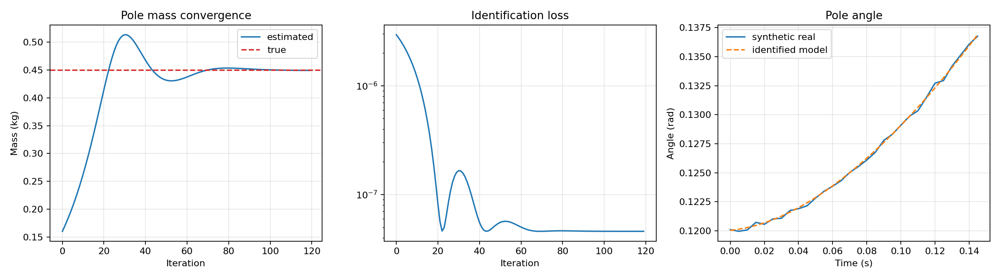
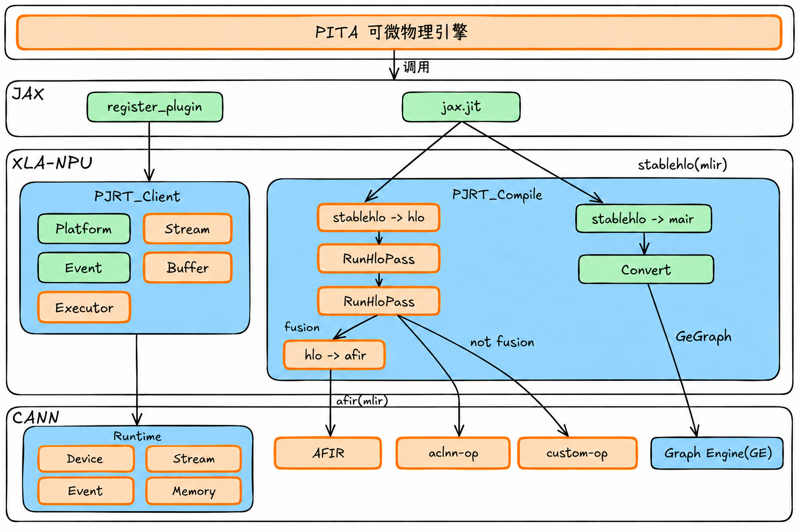

# PITA-Ascend-XLA

## 项目简介

XLA-NPU 是一个面向华为昇腾NPU（Neural Processing Unit）硬件的 XLA（Accelerated Linear Algebra）后端实现。本项目通过接入OpenXLA/XLA开源项目，将XLA开源生态与华为 CANN（Compute Architecture for Neural Networks）软件栈集成，对接JAX框架。JAX框架运行时可以直接加载XLA-NPU，使得基于JAX框架开发的模型可以运行在昇腾NPU上，提供推理场景图编译加速能力。

本项目以华为开源的XLA-NPU为基础，首个支持PITA可微物理引擎以及MuJoCo-XLA等以JAX为后端框架的业务线，能够使其顺利高效的运行在以华为CANN技术为基座的昇腾NPU（Neural Processing Unit）。

## 演示与成果

以下展示各 DEMO 的启动训练示例与最终成果，包含视频及图片素材。

### 🐕 PITA 物理引擎四足行走 DEMO

> 视频中的小狗仅作为训练效果演示。

**启动训练示例**

https://github.com/user-attachments/assets/74a1d120-d83f-44df-be70-57cc0b68b4be

**最终成果**

https://github.com/user-attachments/assets/9109e71e-6189-4de8-bb6f-92297859d830

### 🔬 PITA 物理引擎系统辨识 DEMO

**系统辨识过程**

https://github.com/user-attachments/assets/4bc19061-9149-4855-9582-1d26a85917f3

**最终成果**

## 总体架构

## 代码结构

| 目录 | 主要职责 |
| --- | --- |
| `backend` | Thunk、运行时和 Kernel 代码生成 |
| `service` | 编译流程、HLO 变换和 IR 发射 |
| `pjrt` | PJRT 插件、设备和缓冲区实现 |
| `stream_executor` | NPU 平台、Stream、Event 和设备内存 |
| `dependency` | ACL、ACLNN、GE、AFIR 和 NPUIR 接口 |
| `common` | 配置、常量和通用工具 |
| `docs` | README 引用的图片和视频素材 |

## 支持范围

项目面向华为昇腾 NPU 及其配套 CANN 软件栈，当前支持 Atlas A2 和 Atlas A3 训练及推理系列。具体算子、数据类型和融合能力取决于 NPU 型号及 CANN 版本。

## 开源协议

本项目采用 Apache License 2.0，详见 [LICENSE](LICENSE)。

## 致谢

本项目基于以下开源项目：

- [CANN XLA-NPU](https://gitcode.com/cann/xla-npu)
- [MJX_PITA](https://github.com/pita-ai/MJX_PITA)
- [OpenXLA](https://github.com/openxla/xla) - XLA 编译器框架
- [JAX](https://github.com/google/jax) - 高性能数值计算库
- [StableHLO](https://github.com/openxla/stablehlo) - StableHLO 方言
