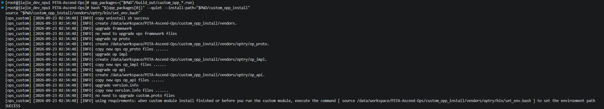

# PITA可微物理引擎在华为NPU中的运行指南
本文的主要记录如何使用本仓库以及上下游依赖完成PITA可微物理引擎在华为NPU的使用(注：目前上游demo暂时开放的仍是MJX，后续渐进开源)。首先我们用到以下三个仓库
- [MJX_PITA](https://github.com/pita-ai/MJX_PITA)（基于MJX的四足机器人PPO异构训练框架）
- [PITA\-Ascend\-XLA](https://github.com/pita-ai/PITA-Ascend-XLA) (本仓库，基于XLA-NPU的完整适配上层业务的Ascend NPU后端)
- [PITA\-Ascend\-Ops](https://github.com/pita-ai/PITA-Ascend-Ops) (本仓库依赖的底层算子库)

首先使用**PITA\-Ascend\-XLA**这个构建上层JAX能够识别到的后端编译器，
再去编译底层算子依赖
最后用MJX_PITA异构训练框架即可完成demo复现。


## PITA\-Ascend\-XLA

1\.进入安装脚本目录

```Plain Text
cd PITA-Ascend-XLA/
```

2\.给脚本添加执行权限

```Plain Text
chmod +x build.sh
```

3\. 运行安装脚本

```Plain Text
./build.sh ${action} --npu-auto-fuse-backend=${backend}
```

\- $\{action\}：表示脚本命令，取值如下

\- install：安装，默认不支持重复安装，如果需要重复安装，需要设置环境变量FORCE\_REINSTALL为1，如：export FORCE\_REINSTALL=1。

\- uninstall：卸载，默认卸载需要二次确认，如果不希望二次确认，需要设置环境变量FORCE\_UNINSTALL为1，如：export FORCE\_UNINSTALL=1。

\- help：帮助，查看build\.sh脚本支持命令的帮助信息。


\- \-\-npu\-auto\-fuse\-backend=\`$\{backend\}\`：表示编译选项，仅$\{action\}为install时支持，可选，\`$\{backend\}\`取值如下：

\- 0：不支持融合, 仅使用aclnn执行

\- 1（默认值）：使用afir后端

\- 3：使用ge后端

这里我们使用afir后端


如图开始编译


编译成功

4\.验证 XLA\-NPU 编译产物

```Plain Text
ls -lh code/xla/bazel-bin/xla/xla_npu/pjrt/c/pjrt_c_api_npu_plugin.so
```


5\.设置环境变量

```Plain Text
source build/xla_npu_env
```

# PITA\-Ascend\-Ops

1\.配置环境

```Plain Text
source /usr/local/Ascend/cann-9.0.0/set_env.sh
```

2\.构建算子包

```Plain Text
bash ./build.sh
```


如图开始构建


构建产物位于 \`build\_out/\`，安装包命名为 \`custom\_opp\_\<系统信息\>\.run\`。\`build\.sh\` 会清理已有的 \`build\_out/\` 内容后重新构建。

3\.安装并加载算子

将算子包安装到仓库下的 \`custom\_opp\_install/\`

```Bash
opp_packages=("$PWD"/build_out/custom_opp_*.run)
bash "${opp_packages[0]}" --quiet --install-path="$PWD/custom_opp_install"
source "$PWD/custom_opp_install/vendors/optry/bin/set_env.bash"
```



4\.验证安装

```Plain Text
bash tests/ut/run_precision.sh
bash tests/ut/run_fma_addcmul_precision.sh
```


验证通过

如果运行脚本没有反应，可以在上面两个sh文件中做出以下修改：


5\.性能测试

```Plain Text
./tests/ut/run_fma_addcmul_precision.sh
./tests/benchmark/run_fma_addcmul_benchmark.sh
```


# MJX\_PITA

1\.训练脚本

```Plain Text
python src/train.py --exp xg_velocity --max_iteration 5000 --num_envs 4096
```


2\.推理

```Plain Text
python src/play.py --exp xg_velocity --checkpoint assets/nn_model/mlp/iteration_1800.pkl --save_video
```

以录视频版本为例，指定模型推理，保存视频。


